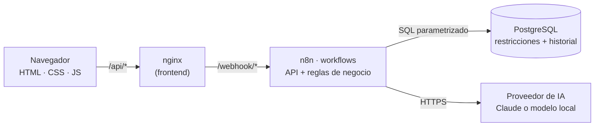

# Campus OPS · Sistema Central de Gestión Operativa de Campuslands

MVP del **Hackatón Campuslands: El campus bajo presión**. Unifica en un solo flujo operativo la
**disponibilidad de espacios**, el **préstamo de recursos tecnológicos** y el **triaje inteligente de
incidencias con IA**, sin asignar nunca un espacio o recurso inhabilitado o en conflicto.

## Contenido

1. [Problema](#problema)
2. [Integrantes](#integrantes)
3. [Stack tecnológico](#stack-tecnológico)
4. [Arquitectura](#arquitectura)
5. [Uso de la inteligencia artificial](#uso-de-la-inteligencia-artificial)
6. [Reglas de negocio](#reglas-de-negocio)
7. [Instalación y ejecución](#instalación-y-ejecución)
8. [Carga del dataset oficial](#carga-del-dataset-oficial)
9. [Guion de demostración](#guion-de-demostración)
10. [Modificar una regla en vivo](#modificar-una-regla-en-vivo)
11. [API (webhooks de n8n)](#api-webhooks-de-n8n)
12. [Estructura del proyecto](#estructura-del-proyecto)
13. [Seguridad](#seguridad)
14. [Solución de problemas](#solución-de-problemas)

---

## Problema

Campuslands crece rápido y hoy gestiona aulas, equipos e incidencias con registros dispersos y
revisiones manuales: hay dobles reservas, préstamos de equipos dañados, incidencias sin dueño y
demoras para atender lo urgente. El sistema resuelve tres frentes conectados:

| Módulo | Qué resuelve |
| --- | --- |
| **1 · Espacios** | Reservas de aulas, cubículos y laboratorios sin cruces de horario ni exceso de aforo, con recomendación de espacio asistida por IA. |
| **2 · Recursos** | Préstamo de equipos con disponibilidad real, plazos, cupo por persona y trazabilidad completa de cada cambio de estado. |
| **3 · Incidencias** | Reporte en lenguaje natural; la IA clasifica, prioriza y enruta al área responsable. |

**Regla central unificada:** una incidencia crítica o alta deja el recurso o espacio afectado en
*mantenimiento* (ya no se puede prestar ni reservar) y, al resolverse, se rehabilita automáticamente.

## Integrantes

| Integrante | Rol |
| --- | --- |
| _Nombre_ | _Rol_ |
| _Nombre_ | _Rol_ |
| _Nombre_ | _Rol_ |
| _Nombre_ | _Rol_ |

## Stack tecnológico

| Capa | Tecnología | Por qué |
| --- | --- | --- |
| Frontend | HTML, CSS y JavaScript (módulos ES, sin frameworks) servido por **nginx 1.30** | Sin compilación; nginx reenvía `/api/*` al backend en el mismo origen (sin CORS). |
| Backend | **n8n 2.43.7** (workflows con webhooks como API REST) | Cada endpoint es un flujo visual: se puede explicar y modificar en vivo. |
| Base de datos | **PostgreSQL 17** | Restricciones de integridad (exclusión de cruces, únicos, claves foráneas) y disparadores de trazabilidad. |
| IA | **Claude** (API de Anthropic, `claude-opus-5-5`) **o** un modelo local/compatible con OpenAI (Ollama, LM Studio…) | Se elige en el `.env` según lo autorizado en la jornada, sin tocar los workflows. |
| Infraestructura | Docker Compose (3 servicios + Ollama opcional) | Instalación reproducible con un solo comando. |

## Arquitectura



**Capas de validación** (de afuera hacia adentro):

1. **Frontend:** solo formato (campos requeridos, números, fechas). Nunca decide reglas de negocio.
2. **n8n (nodos Code):** todas las reglas de negocio, con constantes fáciles de cambiar.
3. **PostgreSQL:** última barrera de integridad, incluso ante peticiones simultáneas
   (p. ej. `EXCLUDE` impide dos reservas activas que se crucen). Sus errores se traducen a mensajes claros.

**Workflows** (carpeta `backend/workflows/`):

| Workflow en n8n | Archivo | Responsabilidad |
| --- | --- | --- |
| Módulo 1 · Espacios y reservas | `m1-espacios-reservas.json` | Espacios, reservas, cancelaciones y recomendación con IA |
| Módulo 2 · Recursos y préstamos | `m2-recursos-prestamos.json` | Inventario, préstamos y devoluciones |
| Módulo 3 · Incidencias y triaje con IA | `m3-incidencias.json` | Reporte, (re)clasificación y ciclo de vida |
| IA · Cliente del modelo | `ia-cliente.json` | **Único** punto que llama al proveedor de IA |
| IA · Triaje de incidencias | `ia-triaje-incidencias.json` | Prompt, control de la respuesta y guardado |
| Incidencias · Efectos en espacios y recursos | `ia-efectos-incidencias.json` | Regla central: bloqueo y rehabilitación |
| Panel · Indicadores, salud e historial | `panel-salud-historial.json` | Indicadores, estado del sistema, trazabilidad, catálogos |
| Datos · Importación del dataset | `datos-importacion.json` | Validación registro por registro y carga |

Cada endpoint es un "carril" horizontal en el lienzo de n8n, con una nota que explica qué reglas aplica.

## Uso de la inteligencia artificial

La IA no es decorativa: participa en tres decisiones del flujo operativo, siempre **controlada** por el sistema.

### 1. Triaje de incidencias (flujo vertical principal)

1. El usuario describe el problema en lenguaje natural ("sale humo del tomacorriente del aula A-201").
2. La incidencia **se registra primero** (nunca se pierde, aunque la IA falle).
3. La IA recibe las **categorías y áreas oficiales desde la base de datos** y devuelve: categoría,
   prioridad, área responsable, espacio/recurso mencionado, resumen, justificación, acción sugerida y confianza.
4. **Control de la respuesta (RN-09):** la salida se pide con un esquema JSON estricto
   (*structured outputs*) y además se valida en n8n contra los catálogos. Si algo no cuadra
   —o la IA no responde— la incidencia queda **pendiente de triaje manual**: el sistema nunca inventa
   una clasificación.
5. Se aplica la **regla central** (RN-10): si es crítica o alta, el recurso o espacio afectado pasa a mantenimiento.

### 2. Recomendación de espacios

Las **reglas descartan primero** los espacios inhabilitados, sin aforo o con cruces. La IA solo puede
elegir entre los candidatos válidos (el esquema lo restringe a esos códigos) según las necesidades
descritas ("práctica de programación, necesitamos computadores"). Si la IA no está disponible, se
aplica la regla de mejor ajuste de aforo y la respuesta lo dice explícitamente (`fuente: "regla"`).

### 3. Devolución con daño

Al devolver un equipo dañado, el sistema crea una incidencia que la IA clasifica automáticamente y
el recurso queda bloqueado hasta que se resuelva.

### Proveedor configurable

| Variable | Claude (Anthropic) | Modelo local / compatible con OpenAI |
| --- | --- | --- |
| `AI_PROVIDER` | `anthropic` | `openai` |
| `AI_MODEL` | `claude-opus-5-5` | p. ej. `llama3.2`, `qwen2.5` |
| `AI_API_KEY` | API key de Anthropic | vacía si el servidor no la pide |
| `AI_BASE_URL` | (vacía) | p. ej. `http://host.docker.internal:11434/v1` |

Con Claude se usan **salidas estructuradas** (`output_config.format`), esfuerzo de razonamiento
`low` (respuestas rápidas, configurable con `AI_EFFORT`) y `fallbacks: "default"`: si el modelo
rechaza una solicitud por sus políticas, la API la reintenta en el modelo de respaldo recomendado
(se desactiva con `ANTHROPIC_FALLBACKS=none`). Con proveedores compatibles con OpenAI se usa
`response_format` con esquema JSON (`AI_JSON_MODE`).

El texto del usuario se trata siempre como **información, no como instrucciones** (protección
contra *prompt injection*), y la API key la inyecta una credencial cifrada de n8n: nunca aparece en
el código ni en el registro de ejecuciones.

## Reglas de negocio

Las reglas viven en los nodos **Code** de n8n, con sus valores como constantes al inicio del nodo.

| Código | Regla | Dónde está (workflow → nodo) | Respaldo en la BD |
| --- | --- | --- | --- |
| **RN-01** | Solo se reservan espacios en estado `disponible`. | Módulo 1 → *Reglas de reserva (RN-01 a RN-04)* | — |
| **RN-02** | Los asistentes no pueden superar el aforo del espacio. | Módulo 1 → *Reglas de reserva* | `capacidad > 0`, `asistentes > 0` |
| **RN-03** | Un espacio no puede tener dos reservas activas que se crucen. | Módulo 1 → *Reglas de reserva* | `EXCLUDE reservas_sin_solapamiento` |
| **RN-04** | Horario 06:00–22:00, duración de 30 min a 4 h, sin fechas pasadas, máximo 30 días de anticipación. | Módulo 1 → *Reglas de reserva* | `hora_fin > hora_inicio` |
| **RN-05** | Solo se prestan recursos `disponible` (no prestados, en mantenimiento ni de baja). | Módulo 2 → *Reglas de préstamo (RN-05 a RN-07)* | índice único: un préstamo activo por recurso |
| **RN-06** | Un préstamo dura máximo 3 días y la devolución debe ser futura. | Módulo 2 → *Reglas de préstamo* | `fecha_limite > fecha_prestamo` |
| **RN-07** | Máximo 2 préstamos activos por persona y ninguno vencido. | Módulo 2 → *Reglas de préstamo* | — |
| **RN-08** | Una devolución con daño deja el recurso en mantenimiento y crea una incidencia clasificada por IA. | Módulo 2 → *Validar devolución* y *Registrar devolución* | — |
| **RN-09** | La respuesta de la IA solo se acepta si usa los catálogos; si no, la incidencia queda pendiente. | IA · Triaje → *Validar clasificación* | FK a catálogos, `incidencias_clasificacion_completa` |
| **RN-10** | Una incidencia abierta crítica o alta bloquea su recurso (o su espacio si es de seguridad o infraestructura). | Efectos → *Decidir efecto (RN-10)* | — |
| **RN-11** | Al no quedar incidencias bloqueantes abiertas, el recurso/espacio se rehabilita. | Efectos → *Aplicar bloqueo o rehabilitación* | — |
| **RN-12** | Transiciones de estado válidas de una incidencia; resolver o cerrar exige comentario. | Módulo 3 → *Validar transición (RN-12)* | `incidencias_estado_valido` |
| **RN-13** | No se habilita un espacio/recurso con incidencias bloqueantes; "prestado" es automático; la baja es definitiva. | Módulos 1 y 2 → *Validar cambio de estado (RN-13)* | — |
| **RN-14** | Cada registro del dataset se valida (campos, tipos, catálogos, duplicados, referencias, aforo, cruces, préstamos activos) antes de insertarse. | Datos → *Validar registros (RN-14)* | todas las anteriores |

**Trazabilidad:** cada cambio de estado de espacios, recursos, reservas, préstamos e incidencias
queda en `historial_estados` mediante disparadores de PostgreSQL, sin importar qué flujo lo hizo
(se ve en el botón de trazabilidad de cada fila y en el panel).

## Instalación y ejecución

**Requisitos:** Docker Desktop (o Docker Engine con Compose v2). No se necesita Node ni nada más.

```bash
# 1. Configuración (el archivo .env no se sube al repositorio)
cp .env.example .env
#    Edita .env: DB_PASSWORD, N8N_ENCRYPTION_KEY y el proveedor de IA autorizado

# 2. Construir y arrancar
docker compose up -d --build

# 3. Seguir el arranque (la primera vez tarda 1–2 minutos)
docker compose logs -f backend      # listo cuando aparece "[campus] Iniciando n8n"
```

| Servicio | URL |
| --- | --- |
| Interfaz | http://localhost:8080 |
| Editor de n8n | http://localhost:5678 (la primera vez pide crear la cuenta de propietario local) |
| PostgreSQL | `localhost:5433` (usuario y clave del `.env`) |

En el arranque, el backend genera las credenciales de n8n a partir del `.env`, importa los workflows
de `backend/workflows/` que hayan cambiado y los publica. Para verificar la IA, usa el botón
**"Probar conexión con la IA"** de la barra lateral: hace una consulta real y muestra la latencia.

### Usar un modelo local (Ollama)

- **Ollama instalado en el equipo:** en `.env` usa `AI_PROVIDER=openai`, `AI_MODEL=<modelo>` y
  `AI_BASE_URL=http://host.docker.internal:11434/v1`.
- **Ollama en Docker:** `docker compose --profile ia-local up -d`, luego
  `docker compose exec ollama ollama pull llama3.2` y `AI_BASE_URL=http://ollama:11434/v1`.

Después de cambiar el proveedor: `docker compose up -d --force-recreate backend`.

### Comandos útiles

```bash
docker compose ps                                   # estado de los servicios
docker compose logs -f backend                      # registros de n8n
docker compose exec db psql -U campus -d campus     # consola SQL
docker compose down                                 # detener (conserva los datos)
docker compose down -v                              # detener y BORRAR todos los datos
```

## Carga del dataset oficial

1. Abre **Datos** en la interfaz y arrastra los archivos (CSV con `,` o `;`, o JSON). Un JSON puede
   ser una lista de registros o un objeto con una lista por entidad: `{ "espacios": [...], "recursos": [...] }`.
2. El tipo de cada archivo se deduce de su nombre (`espacios`, `recursos`, `reservas`, `prestamos`,
   `incidencias`) y se puede corregir antes de importar.
3. **Validar e importar** envía los lotes en orden de dependencias. Por cada archivo se muestran los
   registros cargados, los **rechazados con su fila y motivo** y las advertencias.
4. Cada carga queda en el **historial de importaciones** (tabla `importaciones`) como evidencia.
5. Las incidencias importadas sin clasificar se clasifican con IA desde **Incidencias →
   "Clasificar pendientes con IA"**.

Los nombres de columna admiten variantes (p. ej. `aforo` = `capacidad`, `placa` = `codigo`) y no
distinguen tildes ni mayúsculas. Si el dataset oficial usa otros nombres, agrégalos a la tabla
`ALIAS` del nodo *Validar registros (RN-14)* del workflow *Datos*.

En `backend/data/ejemplo/` hay datos **ficticios** con casos borde intencionales para probar:
códigos duplicados, aforos en cero o negativos, capacidades no numéricas, estados desconocidos,
reservas que se cruzan o exceden el aforo, fechas imposibles (30 de febrero), horas invertidas,
referencias a espacios o recursos inexistentes, préstamos de equipos en mantenimiento, préstamos
devueltos sin fecha y prioridades fuera del catálogo.

## Guion de demostración

1. **Datos:** importar el dataset → mostrar los rechazados con su fila y motivo.
2. **Panel:** indicadores de los tres módulos y actividad reciente (trazabilidad).
3. **Reservas:** una reserva válida y una inválida (más asistentes que el aforo y cruce de horario):
   el sistema lista cada regla incumplida.
4. **Asignación con IA:** describir necesidades → recomendación justificada → reservar con un clic.
5. **Préstamos:** intentar prestar a alguien con un préstamo vencido (RN-07) → rechazo claro.
6. **Incidencia con IA:** "El proyector PROY-02 echa humo y huele a quemado" → la IA la clasifica
   como crítica → el proyector queda en mantenimiento → intentar prestarlo → RN-05 lo impide →
   resolver la incidencia → el proyector vuelve a estar disponible (RN-11).
7. **n8n:** abrir el workflow del módulo y mostrar el carril del endpoint, el nodo de reglas y la
   ejecución con la respuesta de la IA (pestaña *Executions*).

## Modificar una regla en vivo

Ejemplo: "ahora una reserva puede durar máximo 2 horas".

1. Abre http://localhost:5678 → workflow **Módulo 1 · Espacios y reservas**.
2. Doble clic en el nodo **Reglas de reserva (RN-01 a RN-04)**.
3. Cambia `const DURACION_MAXIMA_MINUTOS = 240;` por `120;` y cierra el nodo.
4. Pulsa **Publish** (arriba a la derecha). **Sin publicar, el cambio no afecta a la API.**
5. Prueba desde la interfaz: una reserva de 3 horas ahora se rechaza con el nuevo límite.

| Para cambiar… | Workflow → nodo | Constante o lugar |
| --- | --- | --- |
| Horario, duración y anticipación de reservas | Módulo 1 → *Reglas de reserva* | `HORA_APERTURA`, `HORA_CIERRE`, `DURACION_MINIMA_MINUTOS`, `DURACION_MAXIMA_MINUTOS`, `DIAS_MAXIMOS_ANTICIPACION` |
| Plazo y cupo de préstamos | Módulo 2 → *Reglas de préstamo* | `MAX_DIAS_PRESTAMO`, `MAX_PRESTAMOS_ACTIVOS_POR_PERSONA` |
| Qué prioridades/categorías bloquean | Efectos → *Decidir efecto (RN-10)* | `PRIORIDADES_QUE_BLOQUEAN`, `CATEGORIAS_QUE_BLOQUEAN_EL_ESPACIO` |
| Transiciones de incidencias | Módulo 3 → *Validar transición (RN-12)* | `TRANSICIONES`, `ESTADOS_QUE_EXIGEN_COMENTARIO` |
| Instrucciones de la IA (triaje) | IA · Triaje → *Preparar triaje* | texto de `sistema` |
| Candidatos que ve la IA | Módulo 1 → *Filtrar candidatos (reglas)* | `MAX_CANDIDATOS_PARA_IA` |
| Categorías y áreas del triaje | Base de datos | `INSERT INTO categorias_incidencia ...` (la IA las lee de ahí) |

**Guardar en git lo editado en n8n:** `sh backend/scripts/exportar-workflows.sh` (en Windows,
desde Git Bash) exporta los workflows del contenedor a `backend/workflows/`; luego haz commit. Si se reconstruye sin exportar, al
arrancar se mantiene lo que esté en n8n mientras los archivos del repositorio no cambien;
`N8N_FORZAR_IMPORTACION=true` descarta las ediciones y reimporta todo desde el repositorio.

## API (webhooks de n8n)

Base: `http://localhost:8080/api` (vía nginx) o `http://localhost:5678/webhook` (directo).
Respuestas: `{ "ok": true, "data": …, "message": "…" }` o
`{ "ok": false, "error": { "code", "message", "details": [{ "regla", "mensaje" }] } }`
con el código HTTP correspondiente (400, 404, 409, 422, 500, 502, 503).

| Método | Ruta | Cuerpo / parámetros | Reglas |
| --- | --- | --- | --- |
| GET | `/espacios` | — | — |
| POST | `/espacios` | `codigo, nombre, tipo, capacidad, ubicacion?, equipamiento?` | únicos, aforo > 0 |
| PATCH | `/espacios/estado` | `id, estado, motivo` | RN-13 |
| GET | `/reservas` | `?fecha= &desde= &espacio_id= &estado=` | — |
| POST | `/reservas` | `espacio_id, solicitante, asistentes, fecha, hora_inicio, hora_fin, motivo?` | RN-01 a RN-04 |
| PATCH | `/reservas/cancelacion` | `id, motivo` | solo activas no terminadas |
| POST | `/espacios/recomendacion` | `fecha, hora_inicio, hora_fin, asistentes, necesidades?, motivo?` | RN-01 a RN-03 + IA |
| GET | `/recursos` | `?estado=` | — |
| POST | `/recursos` | `codigo, nombre, tipo, espacio_id?` | únicos, FK |
| PATCH | `/recursos/estado` | `id, estado, motivo` | RN-13 |
| GET | `/prestamos` | `?estado=activo\|vencido\|devuelto` | — |
| POST | `/prestamos` | `recurso_id, solicitante, fecha_limite` | RN-05 a RN-07 |
| PATCH | `/prestamos/devolucion` | `id, con_danio, observaciones?` | RN-08 + IA |
| GET | `/incidencias` | `?estado= &prioridad= &triaje=` | — |
| POST | `/incidencias` | `descripcion, reportado_por, espacio_id?, recurso_id?` | IA + RN-09, RN-10 |
| POST | `/incidencias/triaje` | `id` (reintento con IA) o `id, manual: { categoria, prioridad, area_responsable }` | RN-09, RN-10 |
| PATCH | `/incidencias/estado` | `id, estado, comentario?` | RN-11, RN-12 |
| POST | `/importar` | `entidad, registros[], archivo?` | RN-14 |
| GET | `/importaciones` | — | — |
| GET | `/panel` | — | — |
| GET | `/salud` | `?ia=1` hace una consulta real de prueba a la IA | — |
| GET | `/historial` | `?entidad= &id= &limite=` | — |
| GET | `/catalogos` | — | — |

## Estructura del proyecto

```text
.
├── docker-compose.yml           # db + backend (n8n) + frontend (nginx) [+ ollama opcional]
├── .env.example                 # plantilla de configuración (copiar a .env)
├── backend/
│   ├── Dockerfile               # imagen de n8n con los workflows incluidos
│   ├── docker/
│   │   ├── entrypoint.sh        # credenciales desde .env → importa y publica workflows → n8n
│   │   └── generar-credenciales.js
│   ├── workflows/               # 8 workflows de n8n (la API y las reglas de negocio)
│   ├── database/
│   │   ├── Dockerfile           # PostgreSQL con el esquema incluido
│   │   └── init/                # 01-esquema.sql (tablas, restricciones, disparadores, vistas)
│   │                            # 02-catalogos.sql (categorías y áreas del triaje)
│   ├── data/ejemplo/            # datos ficticios con casos borde
│   └── scripts/exportar-workflows.sh
└── frontend/
    ├── Dockerfile               # nginx con la interfaz
    ├── nginx/default.conf.template   # estáticos + proxy /api → n8n
    ├── index.html
    ├── assets/
    ├── css/                     # variables · base · layout · components · views
    └── js/
        ├── main.js · router.js · config.js
        ├── api/                 # httpClient (fetch central) + un servicio por módulo
        ├── ui/                  # html seguro, modales, notificaciones, estados de carga
        ├── utils/               # formato de fechas, formularios, lector de CSV
        └── vistas/              # panel, espacios, recursos, incidencias, datos
```

### Capa de acceso a la API (frontend)

Todas las peticiones pasan por `js/api/httpClient.js`, que construye la URL y los parámetros,
envía y recibe JSON, corta la petición si supera el tiempo máximo (`AbortController`; más amplio
para la IA y las importaciones) y convierte cualquier fallo —red, tiempo, HTTP o
`{ ok: false }`— en un `ApiError` con un mensaje listo para mostrar. Cada módulo tiene su servicio
(`espaciosApi`, `reservasApi`, `recursosApi`, `prestamosApi`, `incidenciasApi`, `panelApi`,
`datosApi`) y las vistas nunca llaman a `fetch` directamente.

## Seguridad

- **Sin credenciales en el repositorio:** `.env` está en `.gitignore`; las credenciales de n8n se
  generan al arrancar desde variables de entorno y n8n las guarda cifradas con `N8N_ENCRYPTION_KEY`.
- **SQL parametrizado** en todos los nodos de base de datos (sin concatenar datos del usuario).
- **Escape de HTML** en toda la interfaz (la función `` html`…` `` de `js/ui/dom.js`): los datos
  del dataset nunca se interpretan como código.
- **Protección contra prompt injection:** el texto del usuario va delimitado y el prompt indica
  tratarlo como información; además la salida de la IA se valida contra catálogos.
- Datos de ejemplo **100 % ficticios**.

## Solución de problemas

| Síntoma | Solución |
| --- | --- |
| Un puerto ya está en uso | Cambia `FRONTEND_PUERTO_HOST`, `N8N_PUERTO_HOST` o `DB_PUERTO_HOST` en `.env`. |
| "La IA no está configurada" | Completa `AI_API_KEY` (o el proveedor local) y ejecuta `docker compose up -d --force-recreate backend`. |
| La API responde 404 justo después de arrancar | Espera a ver `[campus] Iniciando n8n` en los registros y unos 15 segundos más. |
| Edité un nodo en n8n y la API no cambió | Falta pulsar **Publish** en el editor. |
| Error "Mismatching encryption keys" | Se cambió `N8N_ENCRYPTION_KEY`: restaura la anterior o borra los datos con `docker compose down -v`. |
| Quiero empezar con la base de datos vacía | `docker compose down -v && docker compose up -d --build`. |
| `entrypoint.sh: not found` en Windows | El repositorio fuerza finales de línea LF (`.gitattributes`); vuelve a clonar o convierte el archivo a LF. |
